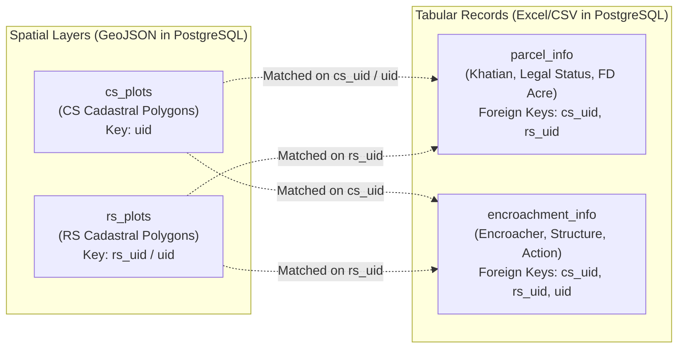
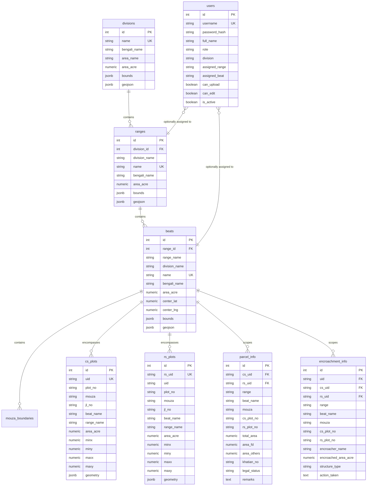

# FD-LMS: Enterprise Database Schema & Data Upload Specification Guide

This guide provides a comprehensive technical overview of the **Forest Department Land Management System (FD-LMS)** backend architecture, PostgreSQL database schema, data relationships, and the exact file formats required for uploading spatial and tabular datasets.

---

## 1. System Architecture & Backend Mechanics

### 1.1 Multi-Tiered Administrative Hierarchy
FD-LMS is architected for nationwide scalability across Bangladesh's forest jurisdictions following this 5-tier spatial and administrative hierarchy:

```
Forest Division (e.g., Biodiversity Conservation Division)
  └── Forest Range (e.g., Bhawal Range, National Park Range)
        └── Forest Beat (e.g., Park Beat, Baupara Beat, BK Bari Beat)
              └── Revenue Mouza (with JL Number)
                    └── Cadastral Plots (CS & RS Surveys)
```

### 1.2 Dual Spatial-Tabular Bridging (`UID` Engine)
The core design principle of FD-LMS separates **heavy spatial geometries** from **frequently edited legal/encroachment records**, bridged by unique identifiers:



1. **Spatial Polygons (`cs_plots`, `rs_plots`)**: Stored in PostgreSQL with pre-calculated bounding boxes (`minx`, `maxx`, `miny`, `maxy`), label coordinates (`label_lat`, `label_lng`), and GeoJSON geometries.
2. **Tabular Dossiers (`parcel_info`, `encroachment_info`)**: Stored as relational records. When a user clicks any plot on the map or searches a plot number, the backend instantaneously joins the tabular dossier by `cs_uid` or `rs_uid`.

---

## 2. Complete Database Entity Relationship (ER) Diagram



---

## 3. Database Table Structures & Column Definitions

### 3.1 `divisions` (Forest Division Level)
| Column | Type | Constraints | Description |
| :--- | :--- | :--- | :--- |
| `id` | `SERIAL` | `PRIMARY KEY` | Auto-incrementing internal ID |
| `name` | `VARCHAR(150)` | `NOT NULL UNIQUE` | English division name (e.g. *Biodiversity Conservation Division*) |
| `bengali_name` | `VARCHAR(200)` | Nullable | Official Bengali name (বন্যপ্রাণী ও প্রকৃতি সংরক্ষণ বিভাগ) |
| `area_name` | `VARCHAR(150)` | Nullable | General geographic area (e.g. *Bhawal National Park*) |
| `area_acre` | `NUMERIC(12, 2)`| `DEFAULT 0.0` | Total declared land area in acres |
| `bounds` | `JSONB` | Nullable | Bounding box coordinates `[[minLat, minLng], [maxLat, maxLng]]` |
| `geojson` | `JSONB` | Nullable | Full multi-polygon GeoJSON boundary geometry |
| `created_at` | `TIMESTAMPTZ` | `DEFAULT NOW()`| Creation timestamp |

### 3.2 `ranges` (Forest Range Level)
| Column | Type | Constraints | Description |
| :--- | :--- | :--- | :--- |
| `id` | `SERIAL` | `PRIMARY KEY` | Internal ID |
| `division_id` | `INTEGER` | `REFERENCES divisions(id)` | Foreign key to parent division |
| `division_name`| `VARCHAR(150)`| `DEFAULT 'Biodiversity...'` | Parent division name |
| `name` | `VARCHAR(150)` | `NOT NULL UNIQUE` | Range name (e.g. *National Park Range*, *Bhawal Range*) |
| `raw_name` | `VARCHAR(150)` | Nullable | Short name without "Range" suffix (e.g. *National Park*) |
| `bengali_name` | `VARCHAR(200)` | Nullable | Bengali name (জাতীয় উদ্যান রেঞ্জ / ভাওয়াল রেঞ্জ) |
| `area_acre` | `NUMERIC(12, 2)`| `DEFAULT 0.0` | Total range area in acres |
| `geojson` | `JSONB` | Nullable | Range spatial polygon GeoJSON |

### 3.3 `beats` (Forest Beat Level)
| Column | Type | Constraints | Description |
| :--- | :--- | :--- | :--- |
| `id` | `SERIAL` | `PRIMARY KEY` | Internal ID |
| `range_id` | `INTEGER` | `REFERENCES ranges(id)` | Foreign key to parent range |
| `range_name` | `VARCHAR(150)` | `NOT NULL` | Parent range name |
| `division_name`| `VARCHAR(150)`| Nullable | Parent division name |
| `name` | `VARCHAR(150)` | `NOT NULL UNIQUE` | Beat name (e.g. *Park Beat*, *Baupara Beat*, *BK Bari Beat*) |
| `bengali_name` | `VARCHAR(200)` | Nullable | Bengali name (পার্ক বিট / বাউপাড়া বিট) |
| `area_acre` | `NUMERIC(12, 2)`| `DEFAULT 0.0` | Total beat area in acres |
| `center_lat` | `NUMERIC(10, 6)`| Nullable | Centroid latitude for map fly-to navigation |
| `center_lng` | `NUMERIC(10, 6)`| Nullable | Centroid longitude for map fly-to navigation |
| `bounds` | `JSONB` | Nullable | Bounding box coordinates |
| `geojson` | `JSONB` | Nullable | Beat spatial polygon GeoJSON |

### 3.4 `rs_plots` & `cs_plots` (Spatial Cadastral Boundaries)
| Column | Type | Constraints | Description |
| :--- | :--- | :--- | :--- |
| `id` | `SERIAL` | `PRIMARY KEY` | Internal ID |
| `uid` / `rs_uid`| `VARCHAR(50)` | `UNIQUE` | Globally unique plot identifier (e.g., `RS_MOUZA_PLOT`) |
| `plot_no` | `VARCHAR(50)` | `NOT NULL` | Cadastral plot number (দাগ নম্বর) |
| `mouza` | `VARCHAR(150)` | `NOT NULL` | Mouza name (মৌজা) |
| `jl_no` | `VARCHAR(50)` | Nullable | Jurisdiction List number (জেএল নং) |
| `beat_name` | `VARCHAR(150)` | Nullable | Scoped Beat name |
| `range_name` | `VARCHAR(150)` | Nullable | Scoped Range name |
| `division_name`| `VARCHAR(150)`| Nullable | Scoped Division name |
| `area_acre` | `NUMERIC(12, 4)`| Nullable | Polygon calculated land area in acres |
| `label_lat` | `NUMERIC(10, 6)`| Nullable | Coordinates where plot label renders |
| `label_lng` | `NUMERIC(10, 6)`| Nullable | Coordinates where plot label renders |
| `minx, miny, maxx, maxy` | `NUMERIC` | Indexed | Bounding box for sub-millisecond spatial viewport queries |
| `geometry` | `JSONB` | `NOT NULL` | GeoJSON Polygon or MultiPolygon geometry coordinates |
| `properties`| `JSONB` | Nullable | Feature properties dictionary |

### 3.5 `parcel_info` (Tabular Land Records & Legal Status)
| Column | Type | Constraints | Description |
| :--- | :--- | :--- | :--- |
| `id` | `SERIAL` | `PRIMARY KEY` | Record ID |
| `cs_uid` | `VARCHAR(50)` | Indexed | Matches `cs_plots.uid` |
| `rs_uid` | `VARCHAR(50)` | Indexed | Matches `rs_plots.rs_uid` |
| `range` | `VARCHAR(150)` | Nullable | Range name |
| `beat_name` | `VARCHAR(150)` | Indexed | Beat name |
| `mouza` | `VARCHAR(150)` | Nullable | Mouza name |
| `cs_plot_no` | `VARCHAR(50)` | Nullable | CS survey plot number |
| `rs_plot_no` | `VARCHAR(50)` | Nullable | RS survey plot number |
| `total_area` | `NUMERIC(12, 4)`| Nullable | Total plot area recorded in Khatian |
| `area_fd` | `NUMERIC(12, 4)`| Nullable | Area owned/notified by Forest Department |
| `area_others`| `NUMERIC(12, 4)`| Nullable | Area claimed or owned by private individuals/institutions |
| `khatian_no` | `VARCHAR(100)` | Nullable | Record of Rights Khatian number (খতিয়ান নং) |
| `legal_status`| `VARCHAR(150)` | Nullable | E.g. *Gazetted Forest (Sec 4/6/20)*, *Acquired*, *Vested* |
| `remarks` | `TEXT` | Nullable | Historical notes, litigation references, or mutations |

### 3.6 `encroachment_info` (Encroachment Case Records)
| Column | Type | Constraints | Description |
| :--- | :--- | :--- | :--- |
| `id` | `SERIAL` | `PRIMARY KEY` | Encroachment record ID |
| `uid` | `VARCHAR(50)` | Indexed | Unique case identifier |
| `cs_uid` / `rs_uid`| `VARCHAR(50)`| Indexed | Links to offending cadastral plot polygon |
| `range` | `VARCHAR(150)` | Nullable | Forest Range |
| `beat_name` | `VARCHAR(150)` | Indexed | Forest Beat |
| `mouza` | `VARCHAR(150)` | Nullable | Revenue Mouza |
| `cs_plot_no` / `rs_plot_no`| `VARCHAR(50)`| Nullable | Encroached plot number |
| `encroacher_name`| `VARCHAR(250)`| Nullable | Name of illegal occupant, business, or entity |
| `encroached_area_acre`| `NUMERIC(12, 4)`| Nullable | Encroached land area in acres |
| `structure_type`| `VARCHAR(150)` | Nullable | E.g. *Permanent Building*, *Semi-pucca*, *Factory*, *Agricultural* |
| `sec_6` / `sec_20`| `VARCHAR(100)`| Nullable | Forest Act legal violation sections |
| `action_taken`| `TEXT` | Nullable | Eviction notices, Forest Court cases (POR), or police actions |

### 3.7 `users` (Role-Based Access Control)
| Column | Type | Description |
| :--- | :--- | :--- |
| `id` | `SERIAL PRIMARY KEY` | User account ID |
| `username` | `VARCHAR(80) UNIQUE` | Unique login username |
| `password_hash`| `VARCHAR(255)` | Salted PBKDF2-HMAC-SHA256 password hash |
| `role` | `VARCHAR(50)` | `admin`, `range_officer`, `beat_officer`, `viewer` |
| `role_title` | `VARCHAR(150)` | Designation (e.g. *Range Officer - Bhawal*) |
| `division` | `VARCHAR(150)` | Assigned Division scope |
| `assigned_range`| `VARCHAR(150)`| Scoped range (limits Range Officer actions) |
| `assigned_beat` | `VARCHAR(150)`| Scoped beat (limits Beat Officer actions) |
| `can_upload` | `BOOLEAN` | Permission to use Ingestion Wizard |
| `can_edit` | `BOOLEAN` | Permission to update records |
| `is_active` | `BOOLEAN` | Active/Disabled toggle |

---

## 4. Required Upload Data Formats

### 4.1 Spatial Boundary Layers (`.geojson` / `.json`)

All spatial datasets must be uploaded in **GeoJSON format** using **WGS84 coordinate reference system (`EPSG:4326`)** with standard `[longitude, latitude]` ordering.

#### A. Division / Range / Beat Boundary Upload
Uploaded via Admin Portal $\to$ **Administrative Jurisdiction Mapping** $\to$ **Upload Boundary**:
```json
{
  "type": "FeatureCollection",
  "features": [
    {
      "type": "Feature",
      "geometry": {
        "type": "Polygon",
        "coordinates": [
          [
            [90.395123, 24.015456],
            [90.412345, 24.015456],
            [90.412345, 24.032100],
            [90.395123, 24.032100],
            [90.395123, 24.015456]
          ]
        ]
      },
      "properties": {
        "name": "Park Beat",
        "bengali_name": "পার্ক বিট",
        "range_name": "National Park Range",
        "division_name": "Biodiversity Conservation Division",
        "area_acre": 3450.00
      }
    }
  ]
}
```

#### B. RS / CS Cadastral Plots GeoJSON Upload
Uploaded via Admin Portal $\to$ **Data Ingestion Engine** (select Target Table: `Plot Boundary (RS)` or `Plot Boundary (CS)`):
```json
{
  "type": "FeatureCollection",
  "features": [
    {
      "type": "Feature",
      "geometry": {
        "type": "Polygon",
        "coordinates": [
          [
            [90.401234, 24.081234],
            [90.402567, 24.081234],
            [90.402567, 24.082987],
            [90.401234, 24.082987],
            [90.401234, 24.081234]
          ]
        ]
      },
      "properties": {
        "plot_no": "1045",
        "mouza": "Baruipara",
        "jl_no": "12",
        "beat_name": "Baruipara Beat",
        "range_name": "Bhawal Range",
        "area_acre": 1.45,
        "uid": "RS_BARUIPARA_1045"
      }
    }
  ]
}
```
> [!TIP]
> If `uid` is omitted in the GeoJSON properties, the backend automatically generates a collision-free UID from `${mouza}_${plot_no}`.

---

### 4.2 Tabular Land Records (`.xlsx`, `.xls`, `.csv`)

The FD-LMS Smart Ingestion Engine automatically detects and maps bilingual English and Bengali headers.

#### A. Parcel Information Sheet (`parcel_info`)
Upload format: Excel workbook (`.xlsx`) or CSV (`.csv`).

| Standard Column Name | Bengali Header Variants | Required? | Example Value | Description |
| :--- | :--- | :--- | :--- | :--- |
| `rs_plot_no` | আরএস দাগ নং, দাগ নং, দাগ নম্বর, Plot No | **YES** | `1045` | Primary cadastral plot number |
| `mouza` | মৌজা, মৌজার নাম, Mouza | **YES** | `Baruipara` | Revenue Mouza name |
| `beat_name` | বিট, বিটের নাম, Beat | Recommended | `Baruipara Beat` | Assigned Beat |
| `range` | রেঞ্জ, রেঞ্জের নাম, Range | Optional | `Bhawal Range` | Assigned Range |
| `cs_plot_no` | সিএস দাগ নং, CS Plot | Optional | `820` | Corresponding CS survey plot |
| `khatian_no` | খতিয়ান নং, খতিয়ান, Khatian | Recommended | `254` | Record of Rights Khatian |
| `area_fd` | বনভূমির পরিমাণ, বন এলাকা, FD Acre | Recommended | `1.45` | Forest department acreage |
| `total_area` | মোট জমি, মোট পরিমাণ, Total Area | Optional | `2.10` | Total plot acreage |
| `area_others` | অন্যান্য, ব্যক্তিমালিকানা, Others Acre | Optional | `0.65` | Non-forest private acreage |
| `legal_status` | আইনি অবস্থা, ভূমির শ্রেণী, Legal Status | Recommended | `Gazetted (Sec 20)` | Forest classification |
| `remarks` | মন্তব্য, বিবরণ, Remarks | Optional | `Under joint re-survey`| Notes |

**Sample CSV structure:**
```csv
rs_plot_no,mouza,beat_name,khatian_no,area_fd,total_area,legal_status,remarks
1045,Baruipara,Baruipara Beat,254,1.45,2.10,Gazetted Forest (Sec 20),Boundary pillar intact
1046,Baruipara,Baruipara Beat,255,0.85,0.85,Notified Forest (Sec 4),Case pending
```

---

#### B. Encroachment Records Sheet (`encroachment_info`)
Upload format: Excel workbook (`.xlsx`) or CSV (`.csv`).

| Standard Column Name | Bengali Header Variants | Required? | Example Value | Description |
| :--- | :--- | :--- | :--- | :--- |
| `rs_plot_no` | দাগ নং, আরএস দাগ, Plot No | **YES** | `1045` | Encroached plot number |
| `mouza` | মৌজা, মৌজার নাম, Mouza | **YES** | `Baruipara` | Revenue Mouza |
| `encroacher_name` | দখলদার, দখলকারীর নাম, Encroacher | **YES** | `Karim Mia` | Individual or company name |
| `encroached_area_acre`| জবরদখলকৃত জমি, দখলকৃত পরিমাণ, Area | Recommended | `0.25` | Encroached area in acres |
| `structure_type` | স্থাপনার ধরন, দখল বিবরণ, Structure | Recommended | `Semi-pucca House`| Permanent / Semi-pucca / Farm |
| `sec_6` / `sec_20` | ধারা ৬ / ধারা ২০, Forest Act Section | Optional | `Sec 20` | Violated statutory notice |
| `action_taken` | গৃহীত ব্যবস্থা, মামলার তথ্য, Action | Recommended | `POR case #12/2025`| Eviction or legal proceedings |
| `beat_name` | বিট, বিটের নাম, Beat | Optional | `Baruipara Beat` | Scoped Beat |

**Sample CSV structure:**
```csv
rs_plot_no,mouza,encroacher_name,encroached_area_acre,structure_type,action_taken
1045,Baruipara,Md. Rafiqul Islam,0.15,Semi-pucca shop,Eviction notice issued
1048,Baruipara,Green Valley Poultry,0.80,Poultry farm,POR Case 14/2026 filed
```

---

## 5. Ingestion Workflow & Smart Processing

When a file is uploaded through the Admin Portal:

1. **Schema Analysis**: The backend parses headers, matches aliases against known English/Bengali variations, and returns a live preview.
2. **Jurisdiction Scope Injection**: The user selects `Division > Range > Beat` in the wizard. The backend automatically tags all incoming records with these administrative scopes.
3. **UID Resolution**: If the incoming file contains plot and mouza, the system matches or generates standard UIDs (`${mouza}_${plot_no}`).
4. **Ingestion Mode**:
   - **Append**: Inserts only new records.
   - **Upsert**: Updates existing records sharing the same UID and appends new records.
5. **Real-Time Snapshot Regeneration**: Upon successful commit, the backend clears memory caches and updates pre-compressed spatial snapshots in `data/cache/` so changes are instantly reflected on the map without a server restart.
